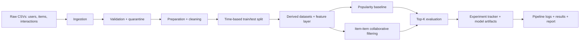
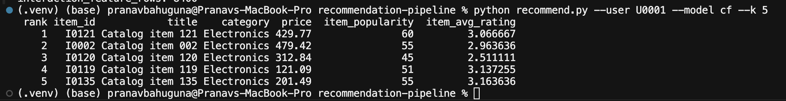

# End-to-End Recommendation Data Management Assignment-2   
  
Name: Pranav Bahuguna 

# Roll no:  2025ae05459

A reproducible, modular recommendation pipeline built for the **Data Management for Machine Learning - Assignment 2**. The example domain is a generic e-commerce catalog. The project uses deterministic synthetic data so the full workflow runs offline and does not depend on a third-party dataset download.

## What is implemented


| Assignment stage    | Implementation                                                                                                                                                | Main output                                                                                                                                  |
| ------------------- | ------------------------------------------------------------------------------------------------------------------------------------------------------------- | -------------------------------------------------------------------------------------------------------------------------------------------- |
| Data ingestion      | Read `users.csv`, `items.csv`, `interactions.csv`; generate deterministic synthetic inputs if needed                                                          | `data/raw/*.csv`                                                                                                                             |
| Data validation     | Missing-value, duplicate-key/ID, numeric type, rating range, timestamp parsing, and user/item referential-integrity checks; bad rows quarantined with reasons | `data/errors/invalid_interactions.csv`, `reports/validation_report.json`                                                                     |
| Preparation         | Type normalization, string standardization, safe dimension defaults, duplicate removal and invalid-row exclusion                                              | `data/processed/*_clean.csv`                                                                                                                 |
| Transformation      | Per-user chronological 80/20 holdout; user activity, item popularity, and user-item matrix                                                                    | `data/processed/train_interactions.csv`, `test_interactions.csv`, `user_activity_summary.csv`, `item_popularity.csv`, `user_item_matrix.csv` |
| Feature management  | User, item and interaction feature tables derived from training data only                                                                                     | `data/features/*.csv`                                                                                                                        |
| Model training      | Bayesian-smoothed popularity baseline and item-item collaborative filtering (cosine similarity)                                                               | `models/*.pkl`                                                                                                                               |
| Evaluation          | Precision@5, Recall@5, NDCG@5, catalog coverage and category-based diversity                                                                                  | `reports/evaluation_results.csv`                                                                                                             |
| Experiment tracking | Local JSON tracker records parameters, metrics, timestamp and artifact paths per run                                                                          | `experiments/*.json`, `experiments/runs.jsonl`                                                                                               |
| Orchestration       | Ordered task runner with dependencies, logging, run summary and failure capture                                                                               | `src/orchestration/pipeline.py`, `reports/pipeline.log`                                                                                      |


## Architecture




## Quick start

Python 3.10+ is recommended.

```bash
# 1. Create and activate a virtual environment
python -m venv .venv
# Windows: .venv\\Scripts\\activate
source .venv/bin/activate

# 2. Install dependencies
pip install -r requirements.txt

# 3. Run the complete workflow from the repository root
python run_pipeline.py

# 4. Optional: regenerate the deterministic raw sample and rerun
python run_pipeline.py --regenerate-data

# 5. Run smoke tests
python -m unittest discover -s tests -v

# 6. Example prediction for a known user
python recommend.py --user U0001 --model cf --k 5
```

The first run creates raw CSV inputs (300 users, 150 items, 10,500 valid interactions, plus deliberate invalid/duplicate records), then executes all pipeline stages. It writes a new run log and experiment records. Re-running without `--regenerate-data` reuses the raw CSVs and refreshes processed outputs.

## Feature catalog


| Entity      | Feature                       | Definition                                                           | Training/prediction use                 |
| ----------- | ----------------------------- | -------------------------------------------------------------------- | --------------------------------------- |
| User        | `age`                         | User age from profile                                                | Optional demographic segmentation       |
| User        | `country`                     | Upper-cased country code                                             | Optional regional segmentation          |
| User        | `user_activity_count`         | Count of training interactions                                       | Activity/popularity personalization     |
| User        | `user_avg_rating`             | Mean training rating for user                                        | User preference strength                |
| User        | `preferred_category`          | Most-interacted category in training history                         | Content preference / cold-start hint    |
| User        | `days_since_last_interaction` | Days between latest training interaction and training reference time | Recency weighting                       |
| Item        | `category`                    | Item taxonomy label                                                  | Content and diversity calculations      |
| Item        | `price`                       | Numeric item price                                                   | Optional ranking feature                |
| Item        | `item_popularity`             | Count of training interactions                                       | Popularity ranking                      |
| Item        | `item_avg_rating`             | Mean training rating                                                 | Item quality prior                      |
| Interaction | `rating`                      | Observed 1-5 rating                                                  | Collaborative filtering signal          |
| Interaction | `event_type`                  | View, click or purchase                                              | Behavioral signal / future weighting    |
| Interaction | `timestamp`                   | UTC interaction timestamp                                            | Chronological split and recency         |
| Interaction | user/item features            | Joined profile and item aggregates                                   | Shared training/prediction feature view |


Feature aggregates and the recommendation models are built from the training partition only to avoid leaking held-out interactions into model inputs.

## Evaluation definitions

- **Precision@5:** relevant recommended items divided by 5.
- **Recall@5:** relevant recommended items divided by the user's relevant held-out items.
- **NDCG@5:** discounted gain of the ranked relevant items, normalized by ideal DCG.
- **Coverage:** unique catalog items recommended across evaluated users divided by catalog size.
- **Diversity:** average per-user fraction of recommendation pairs belonging to different item categories.

A held-out interaction is considered relevant when `rating >= 4`. The models are ranking recommenders; they do not emit predicted rating values, so RMSE/MAE are not applicable. Change `MIN_RELEVANT_RATING` and `TOP_K` in `src/config.py` to adjust evaluation.

## Reproducibility and scheduling

- The synthetic generator uses a fixed seed (`RANDOM_SEED = 42`).
- The holdout is chronological within each user (first 80% train, latest 20% test).
- User/item feature aggregates use the training partition only.
- The orchestration runner writes `reports/pipeline.log` and `reports/run_summary.json`.
- `experiments/` records model parameters, metrics and artifact paths as JSON. This is a transparent, file-based experiment tracker (no tracking server required).

To schedule a daily run using cron (Linux/macOS), edit the path and add:

```cron
0 2 * * * cd /absolute/path/to/recommendation-pipeline && /absolute/path/to/recommendation-pipeline/.venv/bin/python run_pipeline.py >> reports/cron.log 2>&1
```

For Windows, create a Task Scheduler task that runs `python.exe` with argument `run_pipeline.py` and the repository root as its working directory. The orchestrator is intentionally a simple dependency-aware Python workflow, as permitted by the assignment.

## Repository layout

```text
recommendation-pipeline/
├── data/
│   ├── raw/                 # Source CSV data
│   ├── processed/           # Clean data, splits, aggregates, matrix
│   ├── features/            # Reusable feature tables
│   └── errors/              # Quarantined invalid rows
├── src/
│   ├── ingestion/           # CSV ingestion and synthetic generator
│   ├── validation/          # Data quality checks and quarantine
│   ├── preparation/         # Cleaning and standardization
│   ├── transformation/      # Time split and derived datasets
│   ├── features/            # Feature generation
│   ├── training/            # Models and experiment tracker
│   ├── evaluation/          # Ranking metrics
│   └── orchestration/       # End-to-end task dependencies
├── models/                  # Serialized model artifacts
├── experiments/             # Experiment records
├── reports/                 # Logs, validation, evaluation, run summary
├── tests/                   # Smoke tests
├── run_pipeline.py
└── requirements.txt
```


## Limitations and next improvements

This is an educational baseline, not a production deployment. Synthetic data does not represent real user behavior; item-item collaborative filtering has cold-start limitations; category diversity is a simple taxonomy proxy; and the file-based tracker is not a multi-user tracking service. Production extensions could use a public dataset, a feature store, MLflow, a scheduler such as Airflow/Prefect, online serving, drift monitoring and privacy controls.

## Result screenshots from terminal


## Running a sample personalized recommendation



## Submission checklist

- [x] Modular source code and `requirements.txt`
- [x] README setup and execution guide
- [x] Pipeline architecture diagram (Mermaid)
- [x] Validation report and quarantined error dataset
- [x] Feature catalog
- [x] Two recommendation models and comparative evaluation output
- [x] Orchestration workflow and successful-run log
- [x] Capture a screenshot of your own successful terminal run for the submission (the generated `reports/pipeline.log` is included as supporting evidence)
- [x] Short final report PDF (`reports/final_report.pdf`)
- [x] Push this folder to your GitHub repository and submit the repository URL